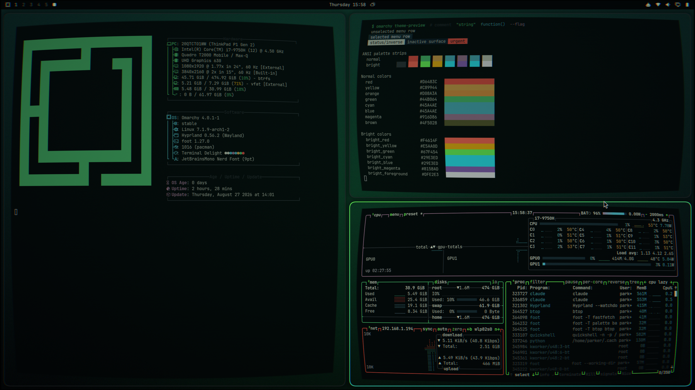

# Terminal Delight — an Omarchy theme

Phosphor green on void black, sampled from the
[Terminal Delight](https://github.com/parker-brown-family/terminal-delight)
terminal's own brand palette.



## Install

```
Omarchy menu (Super + Space) → Install → Style → Theme
https://github.com/parker-brown-family/omarchy-terminal-delight-theme
```

The same thing from a shell:

```bash
omarchy theme install https://github.com/parker-brown-family/omarchy-terminal-delight-theme
```

Either path clones into `~/.config/omarchy/themes/terminal-delight` (replacing
whatever is already there, so don't run it on a machine where you hand-wrote
that directory) and then stages the theme. It is a colours-only theme: every
app Omarchy themes takes its colours from `colors.toml` through Omarchy's own
templates.

## Files

| File | What |
|---|---|
| `colors.toml` | the palette every Omarchy template is generated from |
| `backgrounds/` | fourteen wallpapers the switcher cycles (`omarchy theme bg next`). Osaka Jade's *Shaded Entrance* is the default because sort order picks it. Thirteen are Omarchy's own theme art, carried over unmodified — `backgrounds/ATTRIBUTION.md` says which is whose |
| `icons.theme` | the icon theme, Yaru prussian green |
| `preview.png` | the tile in Omarchy's theme grid |

## The curve, the glass and the paint

The windows in the preview are bowed like the face of a tube by code, and a
theme carries no code, so that lives in three places of its own:

- [**omarchy-terminal-delight-tools**](https://github.com/parker-brown-family/omarchy-terminal-delight-tools)
  — the compositor curve and the glass the preview was shot under, the eleven
  hand-made palettes, and `td-tint`, which paints one terminal without touching
  the theme. It began as a copy of this repository, so their history is there.
- [**Terminal Paint**](https://github.com/parker-brown-family/omarchy-td-palette)
  — an Omarchy plugin that gives every terminal tile on the workspace its own
  Omarchy theme.
- [**Terminal CRT**](https://github.com/parker-brown-family/omarchy-crt) — an
  Omarchy plugin that puts curved glass, scanlines and a phosphor glow over the
  whole desktop, on any theme.

## Light mode

There isn't one. It is a tube.

## Licence

MIT.
